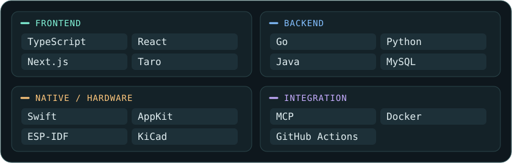
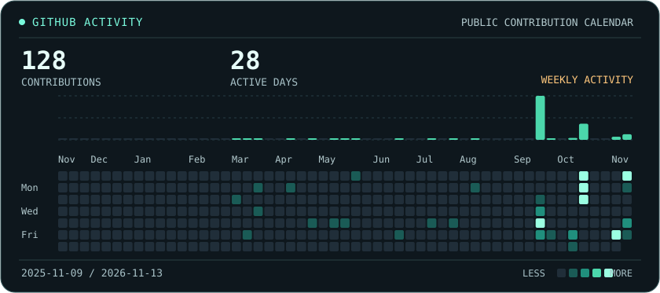

[代表项目](#代表项目) · [技术栈](#技术栈) · [贡献雷达](#贡献雷达) · [全部仓库](https://github.com/hao-527?tab=repositories)

喜欢把反复踩的坑整理成可检索的案例，把反复做的事做成工具。这里放着我的质量工程工具、macOS 小应用、微信小程序和硬件原型。

## 代表项目

- **[BugHub](https://github.com/hao-527/BugHub)** · 按失效机制整理软件 Bug，通过 MCP 让 AI 在写代码或测试用例前检索相似案例。[访问网站 ↗](https://bughub.vip)
- **[agent-activity](https://github.com/hao-527/agent-activity)** · 在 macOS 菜单栏看 Claude Code、Codex 和 DeepSeek Harness 的活动，也给 Kiro 做了像素桌宠。
- **[生活有本谱](https://github.com/hao-527/youbenpu)** · 用一个微信小程序管理家庭账本、点餐和物品库存，后端用 Go 和 MySQL。
- **[PawTrack](https://github.com/hao-527/pawtrack)** · 原型 · 从 4G/GNSS 项圈到微信地图的宠物定位系统，包含固件、定位服务、小程序和 PCB 设计。

**更多工具** · [MacTranslator（划词翻译）](https://github.com/hao-527/MacTranslator) · [Code-Template（工程模板）](https://github.com/hao-527/Code-Template) · [MapTrace（城市旧照片）](https://github.com/hao-527/MapTrace)

## 技术栈

## 贡献雷达

每周更新 · [查看生成脚本](scripts/refresh.py) · [查看更新记录](https://github.com/hao-527/hao-527/actions/workflows/profile.yml)
