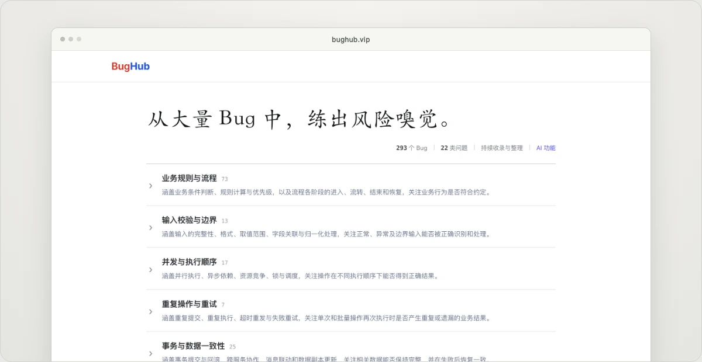
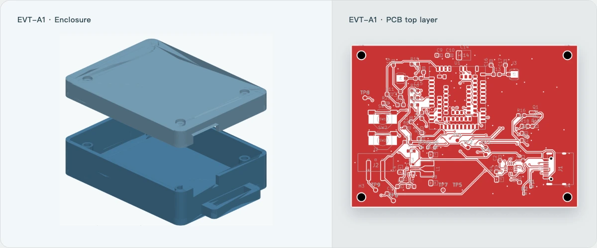

# Hao

我做软件质量工具、macOS 原生应用，也把一些日常需求做成小程序和硬件原型。

[代表项目](#代表项目)　·　[其他作品](#其他作品)　·　[全部仓库 ↗](https://github.com/hao-527?tab=repositories)

---

## 代表项目

### BugHub · 软件失效案例库

把软件故障拆成可检索的案例，按失效机制归档，每条案例都有稳定编号，记录现象、成因和测试要点。开发和测试可以在网站上查阅，编码助手可以通过 MCP 检索。

[访问 BugHub ↗](https://bughub.vip)　·　[源码](https://github.com/hao-527/BugHub)　·　[MCP 接入](https://github.com/hao-527/BugHub/tree/main/bughub-mcp)

### PawTrack · 4G 宠物定位器原型

为宠物项圈做一套独立联网的定位系统。固件采集 GNSS 坐标，经 4G 上传到 FastAPI 服务，微信小程序显示当前位置和历史轨迹。已完成四层 PCB 和外壳设计，实体样机待验证。

[源码](https://github.com/hao-527/pawtrack)　·　[EVT-A1 硬件设计](https://github.com/hao-527/pawtrack/tree/main/hardware/custom/evt-a1)

## 其他作品

- **[agent-activity](https://github.com/hao-527/agent-activity)** · 用 Swift / AppKit 在 macOS 菜单栏显示 Claude Code、Codex 和 DeepSeek Harness 的本地会话状态。Kiro 版用 Python 做成桌面像素宠物。
- **[生活有本谱](https://github.com/hao-527/youbenpu)** · 把家庭账本、点餐和库存放进同一个微信小程序。前端用 Taro / React，API 用 Go / MySQL。
- **[MacTranslator](https://github.com/hao-527/MacTranslator)** · 用 Swift 和系统翻译框架做的划词翻译工具，按 <kbd>⌥</kbd> <kbd>D</kbd> 在光标附近查看译文。
- **[Code-Template](https://github.com/hao-527/Code-Template)** · 为 AI 辅助开发准备的前后端工程模板，包含 Spring Boot 单体与微服务骨架。
